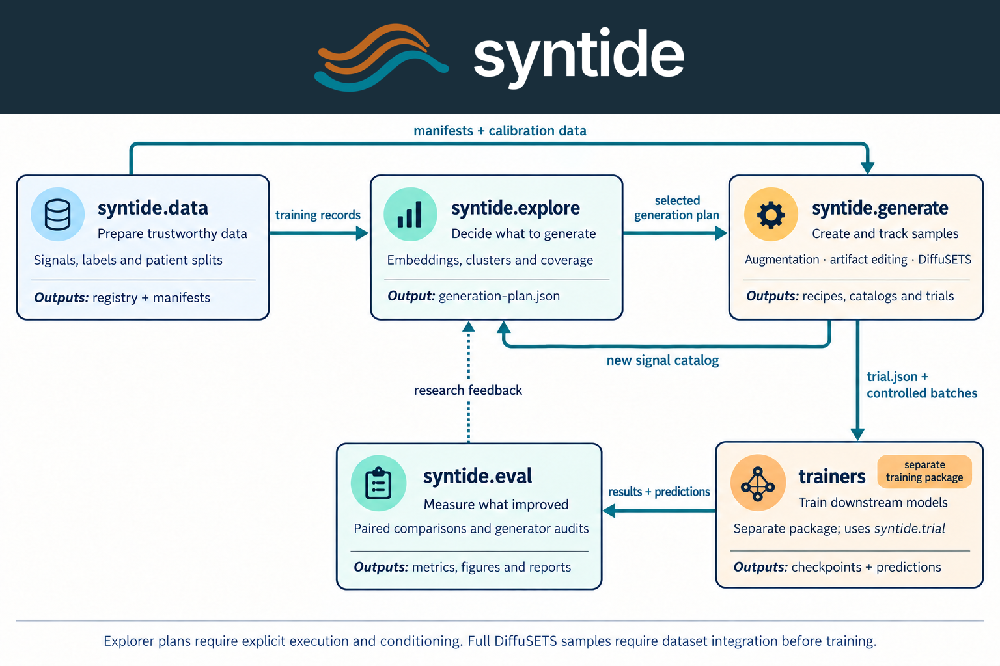

<h1 align="center">
  <picture>
    <source media="(prefers-color-scheme: dark)" srcset="docs/brand/syntide-logo-light.png">
    
  </picture>
</h1>

Syntide helps researchers decide **what synthetic time-series data to generate**, create it,
and measure whether it improves downstream models. It starts with PTB-XL ECGs and supports
exploring custom `(time_series, text)` and `(time_series, question, answer)` datasets.


## Workflow



| Module | Goal | Main output |
|---|---|---|
| `syntide.data` | Prepare signals, labels and patient-separated splits | TimeNet registry and challenge manifests |
| `syntide.explore` | Find coverage gaps and choose generation targets | Interactive explorer and generation plan |
| `syntide.generate` | Augment, edit or generate signals; plan controlled experiments | Recipes, synthetic catalogs and frozen trials |
| `trainers` | Train downstream models through `syntide.trial` | Checkpoints and predictions |
| `syntide.eval` | Audit generation and compare downstream results | Metrics, figures and reports |

Training lives in the separate `trainers/` package. Syntide supplies its data stream and checks
the trial contract; other trainers can implement the same interface.

## Reproduce the presentation experiments

The experiment reference is `../syntide.key`. It presents PTB-XL classification
and seven ECG question-answering comparisons. Start with the saved experiment
packages when reproducing the reported results:

| Experiment | Reproduction package | Contents |
|---|---|---|
| PTB-XL classification | [Classification reproduction](experiments/ptbxl_classification_20261026/README.md) | Data scaling, artifact editing, augmentation sweeps, and DiffuSETS comparisons |
| ECG question answering | [Question-answering reproduction](experiments/ecgqa_seed0_20261025/README.md) | Seven training mixes, original software, input fingerprints, and saved metrics |

Verify both packages and print their saved results without downloading data or
training a model:

```bash
python3 experiments/ptbxl_classification_20261026/reproduce.py verify
python3 experiments/ptbxl_classification_20261026/reproduce.py table
python3 experiments/ecgqa_seed0_20261025/reproduce.py verify
python3 experiments/ecgqa_seed0_20261025/reproduce.py table
```

The packages preserve historical source bytes because the experiments recorded
their hashes. The maintained code in `src/`, `trainers/`, and `scripts/` follows
the current style checks; archived source is excluded from formatting. Use each
package's instructions and recorded environment for an exact historical rerun.
The commands above check saved evidence; they do not rerun model inference.

Raw recordings, prepared datasets, generated signals, model weights, and
checkpoints remain in the local ignored `datasets/`, `outputs/`, and `runs/`
directories. They are useful experiment inputs and evidence. A fresh clone needs
the external inputs described in each package before training. The slide
companion at `../output/ecgqa-slide-kit/` lives outside this repository.

For new classification runs, the [augmentation guide](docs/augmentation_sweep.md)
provides the sweep and lead-reconstruction commands. The real-data scaling check
uses:

```bash
uv run python -m syntide.data challenge.id=ptbxl-scaling \
  'challenge.pool_fractions=[0.1,0.2,0.3,0.5,0.7,1.0]'
uv run python -m syntide.generate protocol=ptbxl_scaling mode=plan
uv run python -m syntide_trainers.torch_loop "runs/ptbxl-scaling/*/*/seed*"
```

## Setup

Install [uv](https://docs.astral.sh/uv/getting-started/installation/) and run commands from this
repository's root (`synthetic_data_engine/`). Python **3.13** is required.

```bash
uv sync --extra explore --extra diffusets
```

This installs Syntide, the reference trainer and the optional exploration/DiffuSETS dependencies.
Use `uv sync` for the core artifact experiment only, or add `--extra wandb` for Weights & Biases.
Exploration and full generation support CPU, Apple MPS and CUDA; `--device auto` selects an
available device. Full generation sets `device` in its JSON configuration.

## Prepare the data

```bash
uv run python -m syntide.data
```

The first run downloads PTB-XL 1.0.3 (about 1.84 GB), builds `datasets/timenet-registry/`, and
writes patient-separated manifests to `manifests/ptbxl-artifact-v2/`. Later runs reuse the data.
Training uses folds 1–8, validation uses fold 9, and the held-out test uses fold 10.

## Explore and generate

### 1. Find a coverage gap

```bash
uv run python -m syntide.explore analyze \
  --dataset ptbxl \
  --manifest manifests/ptbxl-artifact-v2/pool25.json \
  --sample 512 --backend chronos --device auto \
  --output outputs/explore/ptbxl --serve
```

This embeds 512 multichannel recordings from the manifest's depleted training pool. The explorer
shows signal clusters, label counts, metadata slices, text novelty and channel statistics.
Select recordings, choose generation methods and counts, then export a generation plan.

Use `--sample-fraction 0.1` instead of `--sample 512` to sample a fraction. Other sources are
`--dataset ecgqa` and `--dataset jsonl --input catalog.jsonl`; the other signal backend is
`--backend opentslm`. See the [explorer guide](docs/coverage_explorer.md) for formats and options.

To reopen an existing analysis:

```bash
uv run python -m syntide.explore serve outputs/explore/ptbxl
```

### 2. Generate complete ECGs with DiffuSETS

For this example, export a plan containing **only diffusion** and save it as
`outputs/explore/ptbxl/generation-plan.json`. Create `diffusets-config.json` using the
[configuration example](docs/full_generation.md#conditioning-and-configuration).
It specifies model paths, clinical reports, demographics and compatible
**1536-dimensional `text-embedding-ada-002` vectors**. Explorer embeddings cannot replace these vectors.

```bash
# Download pinned model assets once.
uv run python -m syntide.generate.full.assets --output outputs/diffusets-assets

# Execute the first (zero-based) request in the exported plan.
uv run python -m syntide.generate.full \
  --plan outputs/explore/ptbxl/generation-plan.json \
  --config diffusets-config.json --request-index 0 \
  --output outputs/generated/ecg-001
```

The output includes waveforms, a JSONL catalog, per-sample seeds and model/conditioning provenance.
DiffuSETS generates 10-second, 12-lead ECGs. Its native rate is 102.4 Hz; the configuration can
explicitly request resampling to PTB-XL's 100 Hz. See [full generation](docs/full_generation.md)
for conditioning, output schemas and adding another model or modality.

Explorer plans record intentions. The direct plan executor currently handles diffusion requests;
standard augmentation and artifact editing run through the trial workflow below. Generated labels
remain unverified, and full synthetic catalogs need explicit dataset integration before training.

### 3. Inspect generated signals

```bash
uv run python -m syntide.explore analyze \
  --dataset jsonl --input outputs/generated/ecg-001/catalog.jsonl \
  --sample-fraction 1 --backend chronos --no-text \
  --output outputs/explore/generated-ecg --serve
```

A catalog containing both real and synthetic recordings enables origin coloring and paired
waveform comparisons. Use a common channel set and sample rate, and preserve the source-reference
metadata described in the [explorer guide](docs/coverage_explorer.md#compare-real-and-synthetic-signals).

## Train and evaluate the artifact experiment

This workflow compares unchanged real data (A0), standard augmentation (A1), coverage-matched
artifact editing (A2), gap-targeted editing (A3), and real-data controls (C1/C2).
The default protocol plans **72 trials** across two scarcity regimes and six seeds.

```bash
# Calibrate the editor and check its generated artifacts.
uv run python -m syntide.generate protocol=ptbxl_artifact_v2 mode=calibrate

# Write frozen trial.json files.
uv run python -m syntide.generate protocol=ptbxl_artifact_v2 mode=plan

# Freeze evaluation rules before scoring any held-out test data.
uv run python -m syntide.eval protocol=ptbxl_artifact_v2 mode=freeze

# Train planned trials; completed runs are skipped.
uv run python -m syntide_trainers.torch_loop "runs/ptbxl-artifact-v2/*/*/seed*"

# Report validation performance and audit the artifact generator.
uv run python -m syntide.eval protocol=ptbxl_artifact_v2 split=val
uv run python -m syntide.eval protocol=ptbxl_artifact_v2 mode=audit

# Once every planned trial finishes, score the test set once and report.
uv run python -m syntide.eval protocol=ptbxl_artifact_v2 split=test
```

Use the same explicit `protocol` for planning and evaluation: their defaults differ.
Reports are saved under `runs/ptbxl-artifact-v2/eval/`.
Open the local training dashboard with `uv run tensorboard --logdir runs`.

For a small training check, use a separate run directory and select two arms and one seed:

```bash
uv run python -m syntide.generate protocol=ptbxl_artifact_v2 mode=plan runs_dir=runs/smoke \
  'select.arms=[A0,A1]' 'select.regimes=[scarcity25]' 'select.seeds=[0]'
uv run python -m syntide_trainers.torch_loop "runs/smoke/ptbxl-artifact-v2/*/*/seed*"
```

This subset checks training; use the complete protocol for the full set of scientific comparisons.
Quote list overrides and glob patterns as shown, including in zsh.

## ECG-QA-CoT: evidence-grounded synthetic QA

`syntide.generate.qa` turns real, edited and generated ECGs into question–answer–rationale tasks whose
answers come from verified waveform evidence, never from generator controls. It publishes immutable
TimeNet corpora (each waveform stored once; a comparison is one task over two recordings). Corpora reopen
in the explorer. QA trials are planned through a separate, versioned trial seam (`syntide.qa_trial`), and
held-out QA suites are scored once, after the rules are frozen. The QA protocol reuses the RunPod
baseline's split, selection subset, budget, parser and prompt.

```bash
uv run --extra explore --extra diffusets pytest tests/qa -q              # the offline end-to-end check
uv run python -m syntide.generate.qa build --config conf/qa/corpus_grounded.yaml \
  --output outputs/qa/grounded --max-records 64                          # a small real-data build
uv run python -m syntide.generate.qa plan-trials --protocol conf/qa/protocol_ecgqa_cot_qa50.yaml
uv run python -m syntide.eval.qa_holdout freeze runs/ecgqa-cot-qa50 --rules conf/qa/eval_ecgqa_cot_qa50.yaml
```

See [evidence-grounded QA generation](docs/qa_generation.md) for the five capabilities, what is
unsupported, the corpus guarantees and the experiment that measures validation and external gains.

## Development and guides

```bash
uv run --extra explore --extra diffusets pytest
uv run ruff check src tests trainers scripts noxfile.py
uv run ruff format --check src tests trainers scripts noxfile.py
uv run python scripts/check_docstrings.py
uvx nox                 # every CI check: ruff, pyright type checking and tests (uvx nox -s typecheck for one)
```

Type checking covers the paths under `[tool.pyright]` in `pyproject.toml`, starting with `syntide.eval`.

Tests use synthetic fixtures and do not require a PTB-XL download or cloud GPU.
Use the [Google Python Style Guide](https://google.github.io/styleguide/pyguide.html)
for maintained Python: four-space indentation, an 80-column formatting target,
and clear docstrings with `Args`, `Returns`, and `Raises` sections where needed.
Describe experiment variants in words in docstrings. Historical identifiers stay
in configurations and saved records so existing experiments remain readable.

- [Coverage explorer](docs/coverage_explorer.md): datasets, embeddings, metrics, comparisons and plan export.
- [Full generation](docs/full_generation.md): DiffuSETS setup, conditioning and backend extensions.
- [PTB-XL experiment reference](docs/ptbxl_artifact_workflow.md): manifests, calibration, leakage checks, arms, budgets and evaluation rules.
- [Augmentation experiments](docs/augmentation_sweep.md): settings, commands, and reported comparisons.
- [Evidence-grounded QA generation](docs/qa_generation.md): ECG-QA-CoT corpora, QA trials and frozen QA evaluation.
- [Architecture](docs/SYNTIDE_Architecture.md) and [experiment design](docs/SYNTIDE_MVE.md).
