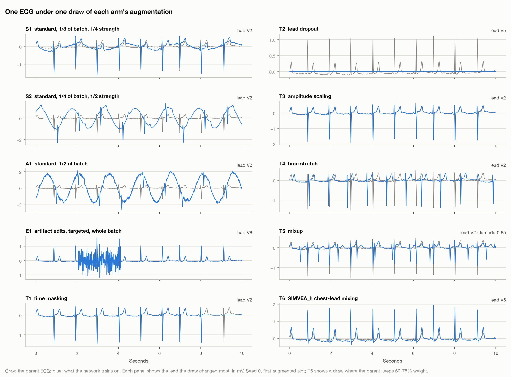
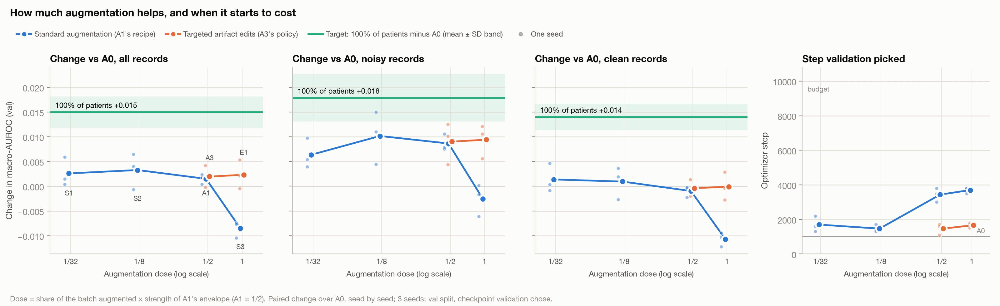
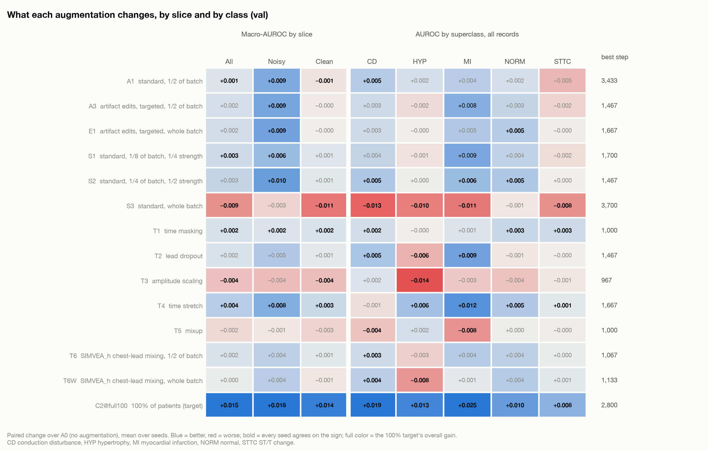
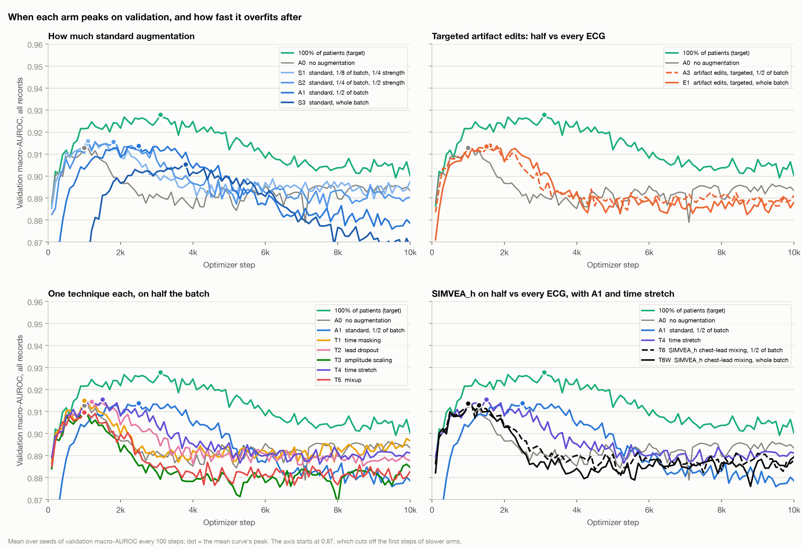
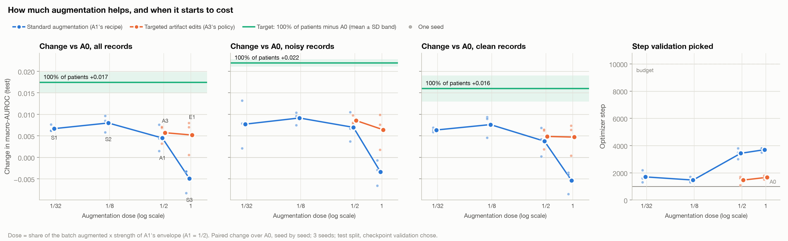
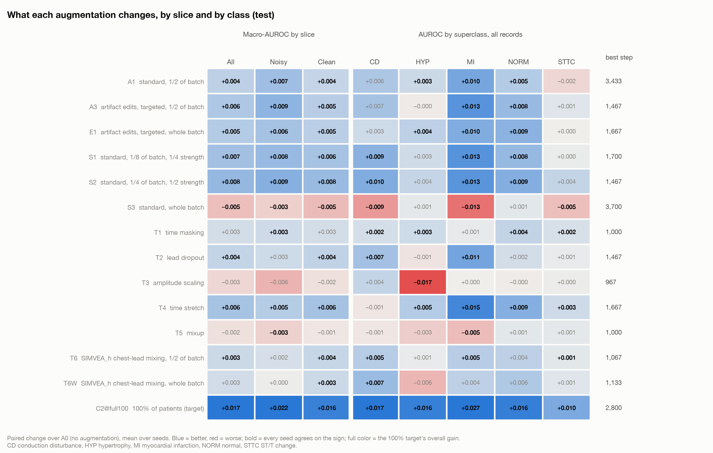
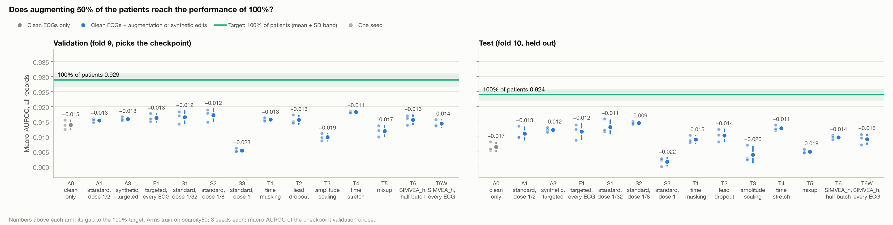
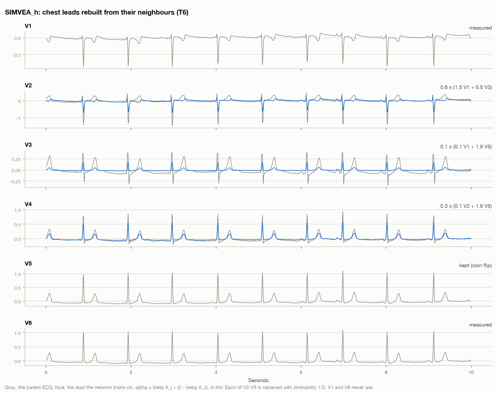

# Augmentation sweep: how much, and which kind, helps at 50% of the patients

Protocol `conf/protocol/ptbxl_aug_sweep.yaml`, rules `conf/analysis/ptbxl_aug_sweep.yaml`, runs in
`runs/ptbxl-aug-sweep/`. 10 new arms and 4 references, 3 seeds each: 42 trials. One more technique,
SIMVEA_h (T6), was added after the test claim under its own protocol, and then the same technique on every
ECG of the batch (T6W) under another; see [Added after the test claim](#added-after-the-test-claim-simvea_h-t6).

## What the 50% experiment showed

`runs/ptbxl-artifact-50-val100`, test fold, paired change over A0 (no augmentation), 3 seeds:

| Arm | All records | Noisy records | Step validation picked |
|---|---|---|---|
| A1 standard augmentation | +0.0045 (3/3 seeds better) | +0.0070 | 3,000–3,800 |
| A3 targeted artifact edits | +0.0057 (3/3) | +0.0085 | 1,100–1,700 |
| C2 every ECG of the 50% pool | +0.0075 (3/3) | +0.0071 | 900–1,700 |
| Target: C2 on 100% of patients | +0.0174 (3/3) | +0.0219 | 2,100–3,200 |
| A0 itself | 0 | 0 | 900–1,100 |

Three things follow:

- Augmentation helps, but the best arm closes only a third of the gap to 100% of patients.
- A1 works as a regularizer: A0 overfits after about 1,000 steps, while A1 keeps improving until about 3,500.
  The editor arms peak almost as early as A0. One artifact on one electrode is a much smaller change than A1's.
- A1 was tested at a single dose: half the batch at a fixed strength. Its baseline wander alone reaches
  3.5 mV, larger than most QRS complexes (see the figure below). We do not know whether more or less of it
  would help, or which of its four operations does the work.

The per-class view of the same runs (`python -m syntide.eval.aug_figure runs/ptbxl-artifact-50-val100 --split test`)
adds a fourth. The gains are not uniform. MI gains most (+0.010 for A1, +0.013 for A3, every seed). STTC
moves by less than 0.003, and the seeds disagree on its sign. HYP gains +0.003 with A1 and nothing with
the editor arms.

## The 10 new arms

Everything that is not the augmentation is the 50% experiment's: the pool (`pool50`, A0's 6,389 clean
ECGs), the model, the optimizer, batch 64, seeds 0–2, validation every 100 steps and the A3 calibration.
Every arm of a seed starts from the same weights and sees the same ECGs in the same order.

**Dose ladder of A1's recipe.** Dose = share of the batch augmented × strength. Strength scales every
range of A1's envelope (gain spread, time shift, noise, wander), so A1 is dose 1/2.

| Arm | Share | Strength | Dose | Question |
|---|---|---|---|---|
| S1 | 1/8 | 1/4 | 1/32 | Almost none: is a trace of augmentation already enough? |
| S2 | 1/4 | 1/2 | 1/8 | Light |
| *A1* | *1/2* | *1* | *1/2* | *Reference* |
| S3 | 1 | 1 | 1 | Every ECG augmented. S3 − A1 isolates the **share** |
| S4 | 1 | 2 | 2 | A lot: wander up to 7 mV, gain ±20%, shift ±1 s. S4 − S3 isolates the **strength** |

**The artifact editor at full share.** E1 = A3's targeted edits on every ECG of the batch. E1 − A3 asks
whether the editor was simply under-dosed, since it peaked as early as A0.

**One technique per arm.** These are common ECG augmentations that A1 does not use. Each one runs alone,
on exactly A1's slots (half the batch), at a moderate strength. Each technique has a class it may hurt, so
the per-class view shows its tradeoff:

| Arm | Technique | Setting | Expected benefit | Risk to watch |
|---|---|---|---|---|
| T1 | Time masking (cutout) | One flat 0.5–2 s window, all leads | Robustness to missing beats or segments | Little; rhythm context is lost in the window |
| T2 | Lead dropout | 1–4 of 12 leads set to 0 mV | Not relying on one lead; robust to lead-off | **MI**, which shows in specific lead groups |
| T3 | Amplitude scaling | One factor in [0.7, 1.43] for all leads | Invariance to gain and body habitus | **HYP**, whose criteria are voltage thresholds |
| T4 | Time stretch | Heart rate and intervals × [0.85, 1.18] | Invariance to heart rate | **CD**, defined by interval lengths (QRS ≥ 120 ms) |
| T5 | Mixup | Blend with a random ECG and its labels, λ ~ Beta(0.4, 0.4) | Smoother decision boundaries, calibration | Clinically implausible inputs; soft labels |



**References, re-run in this protocol** so every contrast is paired: A0, A1, A3, and C2 on 100% of
patients. Training is deterministic and the learning rate constant, so their first 6,500 steps repeat
`ptbxl-artifact-50-val100` exactly. That is a free reproducibility check.

## Budget and cost

One budget for every trial: 10,000 steps, not 6,500. Augmentation delays the peak (A1 peaked at 3,000–3,800
with half the batch augmented), so S3, S4 and E1 might peak after 6,500. The summary flags any arm that
picks a checkpoint past 80% of the budget.

Estimated wall time on the M4 Max (MPS): about 32 ms per step for training and validation, plus each arm's
augmentation, measured on real ECGs. Standard augmentation at full share adds 12 ms per step, the editor at
full share 34 ms, and the techniques 1–3 ms. That is 5.5–11 minutes per trial, and **about 4.6 hours for all
42**. The trainer skips finished trials, so the run can be stopped and resumed.

Actual: 4 h 55 min for all 42 (24–25 October 2026), with one trainer process per seed sharing the GPU. Three
processes were no faster than one (about 23 against 31 steps per second): the small model does not leave
enough of the GPU idle. Per-run wall times are therefore not comparable across arms, so the results use the
step validation picked as the cost of an arm, not minutes.

## Running it

```bash
uv run python -m syntide.generate protocol=ptbxl_aug_sweep mode=plan               # already done
uv run python -m syntide_trainers.torch_loop "runs/ptbxl-aug-sweep/*/*/seed*"
uv run python -m syntide.eval.aug_figure runs/ptbxl-aug-sweep --split val          # any time, from validation
uv run python -m syntide.eval protocol=ptbxl_aug_sweep mode=freeze                 # before the test claim
uv run python -m syntide.eval protocol=ptbxl_aug_sweep split=test                  # paired bootstrap CIs
uv run python -m syntide.eval.aug_figure runs/ptbxl-aug-sweep --split test
uv run python -m syntide.eval.arms_figure runs/ptbxl-aug-sweep                     # the familiar overview
```

To train part of the sweep first, pass several narrower globs, for example
`"runs/ptbxl-aug-sweep/scarcity50/A0/seed*" "runs/ptbxl-aug-sweep/scarcity50/S*/seed*"`.

SIMVEA_h on half the batch (T6) and on every ECG (T6W) have a protocol each, paired with the sweep's runs.
The figures in this document are drawn from all three protocols, without S4:

```bash
uv run python -m syntide.generate protocol=ptbxl_aug_simvea mode=plan              # done
uv run python -m syntide_trainers.torch_loop "runs/ptbxl-aug-simvea/*/*/seed*"     # done, 3 x 6 min
uv run python -m syntide.eval.holdout runs/ptbxl-aug-simvea                        # claims T6's own test fold
uv run python -m syntide.eval.across runs/ptbxl-aug-sweep runs/ptbxl-aug-simvea --split test \
    --contrast T6-A0 --contrast T6-A1                                              # CIs; also --split val
uv run python -m syntide.generate protocol=ptbxl_aug_simvea_whole mode=plan        # done
uv run python -m syntide_trainers.torch_loop "runs/ptbxl-aug-simvea-whole/*/*/seed*"   # done
uv run python -m syntide.eval.holdout runs/ptbxl-aug-simvea-whole                  # claims T6W's own test fold
uv run python -m syntide.eval.across runs/ptbxl-aug-sweep runs/ptbxl-aug-simvea runs/ptbxl-aug-simvea-whole \
    --split test --contrast T6W-T6 --contrast T6W-A0 --contrast T6W-A1 --contrast T6W-S3   # also --split val
uv run python -m syntide.eval.aug_figure runs/ptbxl-aug-sweep runs/ptbxl-aug-simvea runs/ptbxl-aug-simvea-whole \
    --split test --hide S4
uv run python -m syntide.eval.arms_figure runs/ptbxl-aug-sweep runs/ptbxl-aug-simvea runs/ptbxl-aug-simvea-whole \
    --hide S4
```

## How to read the results

- `figures/aug_dose_<split>.png` plots the paired change over A0 against dose on all, noisy and clean
  records, with the 100% target as a band. A fourth panel shows the step validation picked. A curve that
  rises and then falls locates the useful dose. The step panel shows its cost: more augmentation needs more
  training steps.
- `figures/aug_classes_<split>.png` is a heatmap of the paired change per arm, on each slice and each
  superclass. Bold numbers mean every seed agrees on the sign. A technique can help overall and still hurt
  one class; the risks in the table above are the cells to check first.
- `figures/aug_curves.png` plots validation macro-AUROC over training steps for the dose ladder, the editor
  and the techniques, against A0 and the target: how high each arm peaks, when, and how fast it overfits.
- `aug_summary_<split>.md` holds the same numbers, and the share of the gap to 100% that each arm closes.
- `syntide.eval split=test` adds patient-bootstrap CIs. The pre-registered contrasts are:
  - primary: S3 − A1, the share;
  - sequence: E1 − A3, the same question for the editor;
  - diagnostics, reported but never evidence: every arm against A0, every technique against A1, and S4 − S3.
- The figures leave out S4 and include T6 and T6W (SIMVEA_h on half and on every ECG, last section). S4's
  numbers stay in every table and in `aug_summary_<split>.md`.

## Results on validation

All 42 trials, 25 October 2026, written before the test fold was scored (see [Results on test](#results-on-test)). Numbers are the paired change over A0
(no augmentation), mean of 3 seeds, at each run's best validation checkpoint. Brackets are 95% CIs from
`syntide.eval split=val` (crossed bootstrap over patients and seeds). Validation also picked every checkpoint,
A0's included, so every arm's level is slightly optimistic. Source: `runs/ptbxl-aug-sweep/eval/val/results.md`
and `runs/ptbxl-aug-sweep/aug_summary_val.md`.

**Reproducibility.** The 12 reference trials (A0, A1, A3, C2@full100) repeat `ptbxl-artifact-50-val100`
exactly: all 65 shared validation scores are identical, with the same initial weights and the same best step.
None found a better checkpoint between steps 6,500 and 10,000.

### Headline

1. **Nothing comes close to more patients.** The target gains +0.015 [+0.010, +0.020] on all records. The best
   arm, time stretch (T4), gains +0.004 [+0.001, +0.008], 29% of that.
2. **Less augmentation is better.** Light standard augmentation (S1, S2) does at least as well as A1 and peaks
   at half the steps. Augmenting every ECG hurts (S3), and doubling the strength stalls training (S4).
3. **Two kinds of gain.** Noise-type augmentation (A1's recipe, the editor) helps noisy ECGs only. Time
   stretch and time masking also help clean ECGs, on every seed.
4. **Per-class tradeoffs are real but not always the predicted ones.** Amplitude scaling costs HYP, as
   predicted. Lead dropout was expected to cost MI and helps it instead. Mixup costs MI.



### How much: the dose ladder

| Arm | Dose | All records | Noisy | Clean | Best step |
|---|---|---|---|---|---|
| S1 | 1/32 | +0.003 [−0.001, +0.007] | +0.006 [−0.001, +0.014] | +0.001 [−0.003, +0.006] | 1,300–2,200 |
| S2 | 1/8 | +0.003 [−0.001, +0.008] | +0.010 [+0.002, +0.019] | +0.001 [−0.003, +0.006] | 1,300–1,700 |
| A1 | 1/2 | +0.001 [−0.003, +0.005] | +0.009 [−0.000, +0.018] | −0.001 [−0.005, +0.003] | 3,000–3,800 |
| S3 | 1 | −0.009 [−0.013, −0.004] | −0.003 [−0.013, +0.008] | −0.011 [−0.016, −0.006] | 3,500–3,800 |
| S4 | 2 | −0.037 [−0.059, −0.020] | −0.038 [−0.066, −0.012] | −0.037 [−0.060, −0.020] | 9,400–10,000 |
| Target | | +0.015 [+0.010, +0.020] | +0.018 [+0.008, +0.028] | +0.014 [+0.009, +0.019] | 2,100–3,200 |

- **The gain is an inverted U with its top at a light dose.** S2 gets A1's gain on noisy ECGs without A1's
  small cost on clean ones, and needs about 1,500 steps instead of 3,400.
- **The pre-registered primary contrast fails.** S3 − A1 on noisy ECGs is −0.011 [−0.020, −0.002], and on
  clean ECGs −0.010 [−0.014, −0.005]: augmenting every ECG is worse than augmenting half, everywhere. The fixed
  sequence stops there, so E1 − A3 is reported but not tested.
- **S4 stalls before it learns.** Its training loss sits at 0.547, which is what predicting each class's base
  rate gives, for 3,500, 7,000 and 9,100 steps depending on the seed. Two seeds were still rising at step
  10,000, so the summary flags S4 as "may not have peaked". The seed that escaped earliest then had 6,500
  steps and levelled off at about 0.89, still 0.02 below A0, so a longer budget would shrink S4's deficit,
  not reverse it.
- **It is not a BatchNorm artefact.** A model that never sees a clean ECG could carry BatchNorm statistics
  that do not fit clean inputs. Re-estimating every BatchNorm layer on the clean training ECGs (weights
  unchanged) does not help: it lowers S3 by 0.001–0.010 and S4 by 0.011–0.029 (all seeds), and moves A0, A1
  and S2 by less than 0.001 (seed 2). The full-share arms learned worse features.

### The editor at full share

E1 − A3 is +0.000 [−0.004, +0.005] on noisy ECGs and +0.000 [−0.003, +0.003] on clean ones. Editing every ECG
instead of half adds nothing; it moves the peak from about step 1,500 to 1,700. Both gain +0.009 on noisy ECGs
and nothing on clean ones, like A1.

### Which kind: one technique each

| Arm | All records | Noisy | Clean | Per class (bold in the heatmap = every seed agrees) | Best step |
|---|---|---|---|---|---|
| T1 time masking | +0.002 [+0.000, +0.004] | +0.002 [−0.002, +0.005] | +0.002 [−0.001, +0.004] | No class worse | 900–1,100 |
| T2 lead dropout | +0.002 [−0.002, +0.006] | +0.005 [−0.004, +0.013] | +0.001 [−0.004, +0.005] | MI +0.009, CD +0.005; HYP −0.006 | 1,200–1,800 |
| T3 amplitude scaling | −0.004 [−0.007, −0.001] | −0.004 [−0.011, +0.003] | −0.004 [−0.008, −0.001] | HYP −0.014, every seed | 900–1,000 |
| T4 time stretch | +0.004 [+0.001, +0.008] | +0.008 [+0.002, +0.015] | +0.003 [−0.001, +0.007] | MI +0.012, HYP +0.006; CD −0.001 | 1,500–1,900 |
| T5 mixup | −0.002 [−0.006, +0.003] | −0.001 [−0.007, +0.007] | −0.003 [−0.006, +0.002] | MI −0.008, CD −0.004 | 700–1,300 |

- **Time stretch is the best single technique.** With time masking, it is one of only two arms better than A0
  on all, noisy and clean records on every seed. The predicted cost to CD (interval criteria) is small and the seeds disagree on its
  sign. Against A1 it gains +0.003 [−0.001, +0.007].
- **Time masking** is small and uniform: +0.002 on every slice, on every seed, with no class worse.
- **Amplitude scaling** confirms its predicted risk: HYP, diagnosed by voltage thresholds, loses 0.014 on
  every seed. On all records it is the only technique worse than A1 with a CI excluding zero
  (−0.006 [−0.010, −0.001]); on noisy ECGs, mixup is too (−0.009 [−0.018, −0.001]).
- **Lead dropout** refutes its predicted risk: MI gains +0.009 instead of losing. HYP loses 0.006 on every
  seed, plausibly because voltage criteria sum specific leads.
- **Mixup** peaks earliest and helps nowhere; MI and CD lose on every seed.



### When: peaks and overfitting

A0 peaks at about step 1,000, then overfits: its training loss is near zero by step 6,000 (0.003 on seed 2). A1 holds a plateau
from about 2,000 to 4,000 steps, but no higher than A0's peak, and by step 10,000 it is the worse of the two
(all records 0.879 against A0's 0.893, final checkpoints). Light augmentation and the techniques peak almost as
early as A0. S1 and T1 hold up best when the stopping step is wrong (0.897 at step 10,000). So A1's advantage in
the 50% experiment depends on early stopping on validation; S1, S2 and T4 reach a higher peak with less
training.



## Results on test

All 42 trials, scored once on fold 10 on 25 October 2026 (`runs/ptbxl-aug-sweep/test_claim.json`), at the
checkpoints validation picked. The decision rules (`7329468ebc8d`) were frozen before training started.
Brackets are 95% CIs from `syntide.eval split=test`. Fold 10 had already been scored by the 50% experiment, so
it is held out from this sweep's choices but is not a fresh holdout (see Caveats). Source:
`runs/ptbxl-aug-sweep/eval/test/results.md` and `runs/ptbxl-aug-sweep/aug_summary_test.md`.

### Headline on test

1. **The pre-registered result replicates.** S3 − A1 is −0.010 [−0.019, −0.002] on noisy ECGs (validation
   −0.011) and −0.009 [−0.014, −0.005] on clean ones. Augmenting every ECG is worse than augmenting half. The
   sequence stops; E1 − A3 is −0.002 [−0.009, +0.004], reported but not tested.
2. **Still nothing comes close to more patients.** The target gains +0.017 [+0.013, +0.022]. The best arm,
   light standard augmentation (S2), gains +0.008 [+0.004, +0.012], 46% of that.
3. **The ranking holds.** Across the 12 arms, the test order matches validation (Spearman 0.94). S2, S1 and
   time stretch (T4) are the top three on both. T4 was first on validation and S2 is first on test.
4. **The gains are larger on test, and they reach clean ECGs.** From validation to test, A0 loses 0.007 of
   macro-AUROC, more than any arm but S4. The others lose 0.003–0.007 and the target 0.005, so most changes over
   A0 grow. Every arm that helps now also gains on clean ECGs, A1 included (+0.004, against −0.001 on
   validation). The split into noise-type gains and general gains seen on validation was within the noise.
5. **The per-class tradeoffs replicate.** Amplitude scaling costs HYP −0.017 on every seed (validation −0.014).
   Lead dropout helps MI (+0.011) instead of hurting it. Mixup costs MI (−0.005). Time stretch helps MI most
   (+0.015) and leaves CD unchanged (−0.001).

| Arm | All records | Noisy | Clean | Gap closed | Validation, all |
|---|---|---|---|---|---|
| S1 almost none (1/32) | +0.007 [+0.003, +0.010] | +0.008 [−0.002, +0.017] | +0.006 [+0.003, +0.010] | 38% | +0.003 |
| S2 light (1/8) | +0.008 [+0.004, +0.012] | +0.009 [+0.001, +0.017] | +0.008 [+0.004, +0.012] | 46% | +0.003 |
| A1 reference (1/2) | +0.004 [−0.000, +0.010] | +0.007 [−0.003, +0.017] | +0.004 [−0.001, +0.009] | 26% | +0.001 |
| S3 every ECG (1) | −0.005 [−0.010, +0.001] | −0.003 [−0.013, +0.007] | −0.005 [−0.011, +0.000] | −28% | −0.009 |
| S4 every ECG, 2× strength (2) | −0.039 [−0.067, −0.017] | −0.042 [−0.074, −0.015] | −0.038 [−0.066, −0.015] | −227% | −0.037 |
| A3 editor, half the batch | +0.006 [+0.002, +0.010] | +0.009 [+0.000, +0.016] | +0.005 [+0.001, +0.009] | 33% | +0.002 |
| E1 editor, every ECG | +0.005 [+0.000, +0.010] | +0.006 [−0.003, +0.015] | +0.005 [−0.000, +0.009] | 30% | +0.002 |
| T1 time masking | +0.003 [−0.000, +0.005] | +0.003 [−0.001, +0.007] | +0.003 [−0.001, +0.005] | 14% | +0.002 |
| T2 lead dropout | +0.004 [+0.000, +0.008] | +0.003 [−0.007, +0.012] | +0.004 [+0.001, +0.008] | 22% | +0.002 |
| T3 amplitude scaling | −0.003 [−0.007, +0.002] | −0.006 [−0.017, +0.005] | −0.002 [−0.006, +0.003] | −15% | −0.004 |
| T4 time stretch | +0.006 [+0.003, +0.010] | +0.005 [−0.004, +0.013] | +0.006 [+0.002, +0.011] | 36% | +0.004 |
| T5 mixup | −0.002 [−0.005, +0.002] | −0.003 [−0.011, +0.004] | −0.001 [−0.005, +0.004] | −9% | −0.002 |
| Target: 100% of patients | +0.017 [+0.013, +0.022] | +0.022 [+0.012, +0.031] | +0.016 [+0.011, +0.021] | 100% | +0.015 |

Gap closed = the arm's change on all records over the target's (+0.0174).

- **Light beats heavy again.** S2 − A1 is +0.0035 on all records (+0.0018 on validation). This contrast was not
  pre-registered, so it has no CI.
- **No single technique beats A1's recipe with confidence.** T4 − A1 is +0.002 [−0.003, +0.006]. Amplitude
  scaling and mixup are worse than A1: −0.007 [−0.012, −0.003] and −0.006 [−0.011, −0.002] on all records.
- **Two validation findings weaken.** Against A0, S3 (−0.005 [−0.010, +0.001]) and amplitude scaling
  (−0.003 [−0.007, +0.002]) now have CIs that include zero. Both are still clearly worse than A1, and S4 still
  costs 0.039.







## Caveats

- **The test fold has already been viewed.** The 50% experiment and its replication scored fold 10, so
  this sweep is exploratory. Validation picked every checkpoint, and the rules were frozen before training.
- **Each technique is tested at one strength.** A technique that does not help here might help at another
  setting. The dose ladder covers strength only for A1's recipe.
- **Three seeds resolve about ±0.003.** A1's seed SD was about 0.002. Smaller differences show up as mixed
  signs in the heatmap.
- **Time stretch and A1's shift wrap around the end of the record**, which leaves one discontinuity.
- **Mixup** blends with a random parent, not a batch neighbour, and mixes half of the batch, not all of it.

## Next step, deliberately not in this protocol

Combine the techniques that win on validation with A3's targeted edits, at the dose the ladder favours,
as a new arm. Picking that combination from these results and testing it on the same fold would be
selection on the test set. It needs its own protocol and rules, frozen before its own test claim.

On these validation results, the candidate is time stretch plus time masking plus S2's light standard
augmentation, on a quarter to a half of the batch, without amplitude scaling or mixup. The test fold agrees on
S2 and time stretch; time masking is weaker there (+0.003, CI touching zero). The best arm closes 29% of the gap to
100% of patients on validation and 46% on test, so augmentation alone is unlikely to substitute for more
patients.

## Added after the test claim: SIMVEA_h (T6)

SIMVEA_h (Lim, Lee, Jang and Joo, *Biomedical Engineering Letters* 15:377–388, 2025,
doi:10.1007/s13534-024-00455-3) imitates a misplaced chest electrode. Chest electrodes are placed by touch,
so their positions vary between recordings of one patient while the diagnosis does not. The method rebuilds
chest leads V2–V5 as a weighted sum of two chest leads on either side of them, and keeps the labels.



### Implementation

`syntide.generate.simvea` (generator `simvea@1`), written from the paper and its Supplementary Appendix 1:

| Setting | Value | Source |
|---|---|---|
| New lead | α (β X<sub>j</sub> + (2 − β) X<sub>z</sub>) | Table 2 |
| Leads replaced | V2–V5, each independently with probability 1/2; V1 and V6 never | §2.2, §2.4 |
| Pairs (j, z) | V2: (V1, V4), (V1, V3). V3: (V2, V4), (V1, V5). V4: (V3, V5), (V2, V5), (V1, V6). V5: (V4, V6), (V3, V6). One drawn uniformly | Fig. 1c, Supp. Appendix 1 |
| α | uniform on {0.1, 0.2, …, 1.0} | Supp. Appendix 1 |
| β | uniform on {0.0, 0.1, …, 2.0} | Supp. Appendix 1 |

Where the paper is silent:

- α, β and the pair are drawn for each replaced lead, not once per ECG, and every new lead is built from
  measured leads, never from a lead replaced in the same draw.
- The paper normalizes after augmenting but does not say how. Our model takes millivolts unchanged, so α
  scales the replaced lead's amplitude, as in the paper's Supplementary Fig. 1: at α = 0.1 the new lead is a
  small fraction of its neighbours.
- The code at `github.com/rpopgmp/TimofeevAV` (`code/simvea.py`) has the same pairs and formula, but replaces
  each lead with probability 0.3 instead of the paper's 0.5 and draws from NumPy's global random state. It was
  not used.

Like T1–T5, T6 augments A1's half of the batch at the paper's random hyperparameters. The paper augments every
ECG, so its share is twice T6's. In 1 of 16 augmented slots no lead is replaced, as in the paper. T6W
([below](#every-ecg-of-the-batch-t6w)) is T6 on every ECG.

### How it was run

The sweep's test fold is claimed for its 42 trials, and a claim never takes another trial. T6 therefore has its
own protocol, `conf/protocol/ptbxl_aug_simvea.yaml` (runs in `runs/ptbxl-aug-simvea/`), identical to the sweep
except for the arm. Nothing of the sweep was retrained, and its `plan.json`, frozen rules and test claim are
unchanged.

SYNTIDE keys every random stream by seed, step and slot, never by arm or protocol, so T6 is paired with the
sweep's runs. Checked:

- every seed starts from the same weights as A0 and A1, with the same trainer (fingerprint `d93b8d026d15`);
- in seed 0, T6's ledger and A1's name the same parent ECG in every one of the 320,000 transform slots;
- re-planning the sweep with the new code gives the same 42 trial ids.

The contrasts reported here were written in the protocol before training: T6 − A0 and T6 − A1. T6 − T4 (time
stretch, the best technique) was added afterwards. They are diagnostics, like every other technique.
`syntide.eval.across` computes them with the sweep's frozen bootstrap (rules `7329468ebc8d`: 2,000 crossed
draws over patients and seeds). As a check, it gives T4 − A0 exactly as published above, on both folds.
T6 was scored on fold 10 under its own claim (`runs/ptbxl-aug-simvea/test_claim.json`), after its validation
results were written down. Sources: `runs/ptbxl-aug-simvea/eval/{val,test}/across.md` and
`runs/ptbxl-aug-sweep/aug_summary_{val,test}.md`.

### Results

Paired change over A0, mean of 3 seeds, at each run's best validation checkpoint, in the formats of the tables
above:

| Arm | Split | All records | Noisy | Clean | Per class (all seeds agree in bold) | Gap closed | Best step |
|---|---|---|---|---|---|---|---|
| T6 SIMVEA_h | val | +0.002 [−0.001, +0.006] | +0.004 [−0.002, +0.011] | +0.001 [−0.002, +0.005] | **CD +0.003**, MI +0.004, NORM +0.004, STTC +0.000; HYP −0.003 | 11% | 900–1,300 |
| T6 SIMVEA_h | test | +0.003 [+0.000, +0.006] | +0.002 [−0.004, +0.010] | +0.004 [+0.001, +0.007] | **CD +0.005**, **MI +0.005**, NORM +0.004, **STTC +0.001**, HYP +0.001 | 18% | 900–1,300 |

| Contrast | Split | All records | Noisy | Clean | Seeds better, all |
|---|---|---|---|---|---|
| T6 − A1 | val | +0.000 [−0.004, +0.004] | −0.005 [−0.014, +0.003] | +0.002 [−0.003, +0.007] | 2/3 |
| T6 − A1 | test | −0.001 [−0.006, +0.003] | −0.005 [−0.015, +0.007] | −0.000 [−0.005, +0.004] | 2/3 |
| T6 − T4 | val | −0.003 [−0.006, +0.001] | −0.005 [−0.013, +0.003] | −0.002 [−0.007, +0.003] | 0/3 |
| T6 − T4 | test | −0.003 [−0.007, +0.000] | −0.003 [−0.013, +0.008] | −0.003 [−0.007, +0.002] | 0/3 |

- **A small gain, no better than A1's recipe.** On test, T6 gains +0.003 over A0 on all records, every seed
  better, with a CI that only just excludes zero (lower end +0.0004). That closes 18% of the gap to 100% of
  patients (11% on validation). Against standard augmentation on the same slots it is −0.001
  [−0.006, +0.003], and it is below time stretch on every seed of both folds.
- **It is not a noise augmentation.** On test the gain is on clean ECGs (+0.004 [+0.001, +0.007]), not on
  noisy ones (+0.002, seeds disagree). On noisy ECGs it trails A1 by 0.005 on both folds, as expected from an
  augmentation that adds no noise. On validation the split goes the other way, so neither slice is a finding.
- **The expected risk to MI did not appear.** MI is read from chest-lead patterns, and SIMVEA_h rewrites chest
  leads, yet MI gains +0.004 on validation and +0.005 on test, where every seed agrees. Conduction disturbance (CD) gains on
  every seed on both folds, +0.003 and +0.005. No class loses on test.
- **It peaks as early as A0** (steps 900–1,300 against 900–1,100) and declines like the other techniques, so
  it does not act as a regularizer the way A1 does (fourth panel of the curves figure).
- **This matches the paper on PTB-XL.** With random α and β, the paper's SIMVEA_h scored 0.9571 (NORM) and
  0.9453 (MI) against a baseline of 0.9577 and 0.9460 (Table 3); its gains were on the rhythm datasets.

Caveats:

- One setting of α and β: the paper's random ones, on half the batch here and on every ECG in T6W below.
  The paper's own fixed-α results on PTB-XL (Supplementary Table 5) were best at α = 0.4 and 0.6;
  choosing α from them was not tried.
- Fold 10 has now been scored for this sweep, its replication and T6. T6's numbers are exploratory, like the
  rest of the sweep.
- Seed 0 carries most of the validation gain (+0.0045 against +0.0006 and −0.0000).

### Every ECG of the batch (T6W)

T6 augmented half the batch, like the other techniques; the paper augments every ECG. T6W is T6 with every
slot augmented (`transform_fraction: 1.0`), so T6W − T6 isolates the share, as S3 − A1 and E1 − A3 do above.
It has its own protocol, `conf/protocol/ptbxl_aug_simvea_whole.yaml` (runs in `runs/ptbxl-aug-simvea-whole/`),
because the sweep's and T6's test claims are spent. Its trials differ from T6's in three fields only: arm,
protocol and share. Nothing else was retrained. Training took 6–8 minutes per seed on MPS.

Checked on all three seeds (`runs/ptbxl-aug-simvea-whole/scarcity50/T6W/seed*/recipes.parquet`):

- each seed starts from the same weights as A0, A1 and T6, with the same trainer;
- all 640,000 slots (64 × 10,000 steps) are augmented, once each;
- in each of the 320,000 slots T6 augmented, T6W has the same parent ECG, leads, pairs, α, β and seed key,
  so the same augmented ECG; in A1's slots it has A1's parents;
- the number of chest leads replaced per ECG matches Binomial(4, 1/2), with none replaced in 1 of 16.

The contrasts were written in the protocol before training: T6W − T6 and T6W − A0, with T6W − A1 and T6W − S3
(standard augmentation on every ECG) shown alongside. The validation results
(`runs/ptbxl-aug-simvea-whole/eval/val/across.md`) were written before T6W claimed its own test fold. CIs are
from `syntide.eval.across` with the sweep's frozen bootstrap, as for T6.

| Arm | Split | All records | Noisy | Clean | Per class (all seeds agree in bold) | Gap closed | Best step |
|---|---|---|---|---|---|---|---|
| T6W SIMVEA_h, every ECG | val | +0.000 [−0.003, +0.005] | +0.004 [−0.004, +0.013] | −0.001 [−0.005, +0.004] | **CD +0.004**, MI +0.001, NORM +0.004, STTC +0.001; **HYP −0.008** | 3% | 1,000–1,300 |
| T6W SIMVEA_h, every ECG | test | +0.003 [−0.002, +0.007] | +0.000 [−0.008, +0.009] | +0.003 [−0.001, +0.008] | **CD +0.007**, MI +0.004, NORM +0.006, STTC +0.001; HYP −0.006 | 15% | 1,000–1,300 |

| Contrast | Split | All records | Noisy | Clean | Seeds better, all |
|---|---|---|---|---|---|
| T6W − T6 | val | −0.001 [−0.003, +0.001] | +0.000 [−0.004, +0.005] | −0.002 [−0.004, +0.001] | 0/3 |
| T6W − T6 | test | −0.001 [−0.003, +0.003] | −0.002 [−0.008, +0.005] | −0.000 [−0.003, +0.003] | 1/3 |
| T6W − A1 | val | −0.001 [−0.005, +0.003] | −0.005 [−0.015, +0.004] | +0.000 [−0.005, +0.005] | 1/3 |
| T6W − A1 | test | −0.002 [−0.006, +0.002] | −0.007 [−0.016, +0.003] | −0.000 [−0.005, +0.004] | 0/3 |
| T6W − S3 | val | +0.009 [+0.005, +0.013] | +0.007 [−0.004, +0.017] | +0.010 [+0.005, +0.015] | 3/3 |
| T6W − S3 | test | +0.008 [+0.003, +0.012] | +0.004 [−0.006, +0.014] | +0.009 [+0.004, +0.013] | 3/3 |

- **Augmenting every ECG adds nothing over half.** T6W − T6 is −0.001 on both folds, with CIs within ±0.003;
  no seed is better on validation and one of three on test. Over A0, T6W gains +0.000 on validation and +0.003
  on test, both CIs including zero (T6's test CI only just excluded it). It closes 15% of the gap to 100% of
  patients on test, against T6's 18%. T6's small gain was not for want of dose.
- **Unlike standard augmentation, SIMVEA_h does not collapse on the whole batch.** Going from half to every ECG
  cost standard augmentation 0.009 (S3 − A1) and SIMVEA_h 0.001. T6W beats S3 by 0.008–0.009 on every seed of
  both folds. That fits what each changes: S3 changes every lead of every ECG (gain, noise and wander per
  lead, and a time shift), while SIMVEA_h never touches the limb leads, V1 or V6, and leaves 1 ECG in 16
  unchanged.
- **The cost falls on hypertrophy.** HYP is lower than in T6 on every seed of both folds (−0.005 on
  validation, −0.006 on test), and lower than in A0 on every validation seed (−0.008; −0.006 on test, two seeds
  of three). Hypertrophy criteria are voltage thresholds, several of them on the rebuilt leads (Cornell uses
  S in V3, Sokolow–Lyon R in V5), and α rescales a rebuilt lead's amplitude. With every ECG augmented, each of
  V2–V5 shows its measured voltage only half the time. Amplitude scaling (T3) has the same weak spot (HYP
  −0.017 on test). On half the batch, T6 left HYP unchanged on test (+0.001).
- **CD gains on every seed over A0 on both folds** (+0.004, +0.007), as with T6. MI is lower than in T6 on
  validation (−0.004, from two seeds; the third is unchanged) and unchanged on test (−0.000).
- **It peaks about when T6 and A0 do** (steps 1,000–1,300, against 900–1,300 and 900–1,100), so the extra
  augmentation does not delay the peak the way A1's does (fourth panel of the curves figure).

Caveats:

- Fold 10 has now also been scored for T6W. Like T6, these are diagnostics, not fresh claims.
- Per-class AUROCs have no CIs here, and HYP is the rarest superclass (about 12% of PTB-XL records), so its
  per-class AUROC is the noisiest. "Every seed" is the only consistency check behind the HYP finding.
