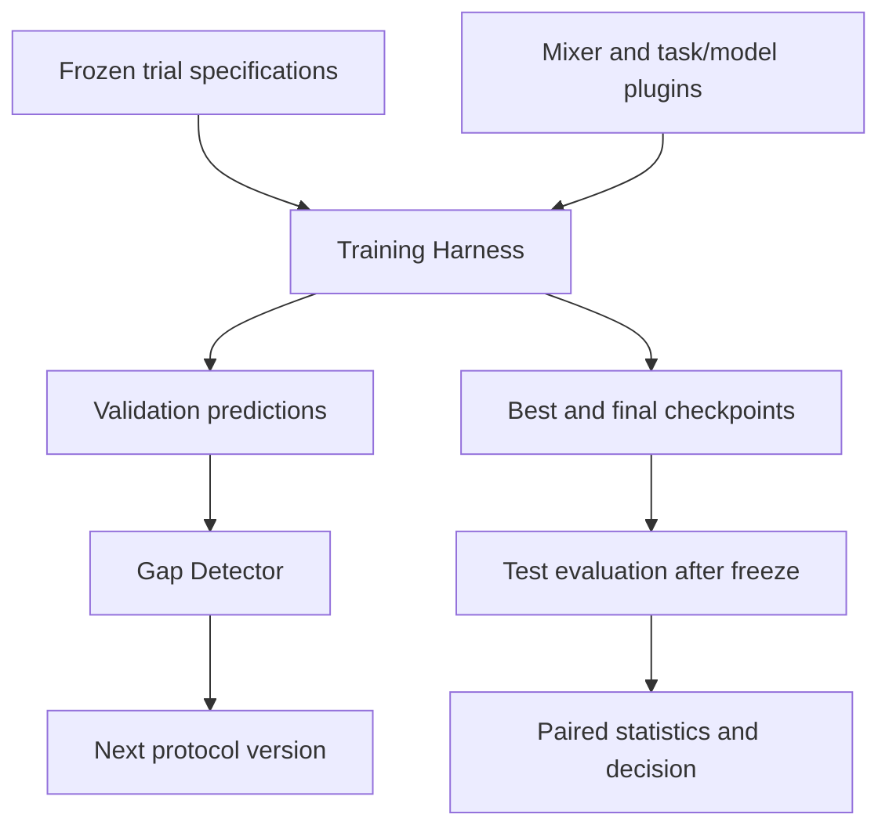

> **Status (2026-10-21): partly superseded.** Training now lives outside the `syntide` package.
> - SYNTIDE writes a frozen `trial.json` per run and owns the batches, the step budget, the ledger and the checks, through `syntide.trial`.
> - Any trainer consumes them. The first one is plain PyTorch in `trainers/`, not Lightning.
> - The grid is planned by `python -m syntide.generate mode=plan`, not by Hydra multirun.
>
> The harness invariants in §4 still hold. See `docs/implementation_plan_v2.md`, Phase 2.

**For SYNTIDE, I would revise my recommendation to: Hydra + explicit typed protocol schemas + Lightning, with a small SYNTIDE-owned trial runner.** Keep YAML as the readable experiment definition; use `hydra-zen` selectively to construct models and plugins.

For the initial M1 Max experiment, I would run trials sequentially. Add Ray or a Slurm launcher when you move to a cluster.

The reason is specific to your design: **the harness must preserve a controlled experiment across 72 runs**—including paired inputs, matched budgets, frozen generator policies, checkpoint selection and test isolation. Those requirements deserve an explicit interface that remains stable when implementation classes change. Your v2 review already specifies most of that contract. SYNTIDE — MVE review and modular engine design.md

## 1. The stack I would use

| Layer | Recommendation for SYNTIDE | Purpose |
|---|---|---|
| **Experiment definition** | **Hydra + structured dataclasses + small YAML groups** | Define and validate arms, regimes, seeds, budgets, manifests and evaluation rules. |
| **Component construction** | Ordinary factories; **hydra-zen optional** | Reduce repetitive construction code for models, generators and callbacks. |
| **One training run** | **Lightning Trainer** | Handle training, devices, validation and checkpoints. |
| **Paired data stream** | A small custom **Mixer / sampler** | Enforce parent schedules, transformed slots, recipe randomness and exposure accounting. |
| **Results and provenance** | Existing **Parquet / DuckDB ledger**, with per-trial artifacts | Connect configurations, recipes, checkpoints, predictions and decisions. |
| **Execution** | Hydra’s sequential launcher initially | Execute the experimental matrix; replace the launcher when resource scheduling becomes necessary. |

Hydra supports dataclasses as configuration schemas while retaining YAML composition and native multirun. `hydra-zen` derives configurations from function and class signatures. For SYNTIDE, I would use explicit schemas for the scientific protocol and generated configurations where they simplify internal construction. [hydra.cc](https://hydra.cc/docs/1.3/tutorials/structured_config/intro/?utm_source=chatgpt.com)

**I would keep the main 72-run matrix exhaustive.** Adaptive optimization can help during the validation-only pilot, before you freeze common hyperparameters and training budgets. The main comparison should complete every prescribed arm under its assigned budget.

## 2. Give the Training Harness a narrow interface

The central boundary should be:

```python
run_trial(spec: TrialSpec) -> RunResult
```

`TrialSpec` describes **one arm × one scarcity regime × one replicate seed**, with concrete references to its inputs.

| `TrialSpec` contains | `RunResult` contains |
|---|---|
| Protocol version and trial identity | Completion/failure status and attempt identity |
| Exact training and validation manifests | Best-validation and final checkpoints |
| Task, model and optimizer configuration | Per-record validation predictions |
| Numeric training budget and checkpoint rule | Actual updates, presentations and transformed slots |
| Parent schedule and randomness plan | Recipe/validation ledger references |
| Generator, calibration and acceptance-policy versions | Metrics, environment and artifact checksums |

Keep configuration composition at the entry point. The shared training code should receive ordinary typed objects and plugin interfaces, without needing to understand Hydra.

I would also separate the current **“Mixer + Harness”** responsibilities into training, stream construction, and statistical analysis. This preserves the shared-engine boundary described in your architecture. SYNTIDE_Architecture(1).md



The feedback branch matters: **validation findings can inform the next protocol version**. During the main 72-run comparison, the generator calibration, targeting policy and acceptance rules should remain frozen.

## 3. Express the 72 runs as a native Hydra grid

Your current configuration includes:

```yaml
challenge:
  pool_fraction: [0.10, 0.25]

training:
  seeds: 6
  steps: from_pilot
```

Before execution, I would make three things explicit:

- Named regimes with their frozen manifests.
- Actual seed values, for example `[0, 1, 2, 3, 4, 5]`.
- Numeric step budgets selected by the pilot.

A YAML list does not automatically request a Hydra sweep, and a seed count does not identify the paired seeds.

### Proposed configuration interface

This is a proposed SYNTIDE entry point, rather than code already present in the attachments:

```yaml
# conf/train.yaml
defaults:
  - protocol: ptbxl_artifact_v2
  - arm: A0
  - regime: scarcity25
  - runtime: mps
  - _self_

replicate_seed: 0

hydra:
  sweeper:
    params:
      arm: "A0,A1,A2,A3,C1,C2"
      regime: "scarcity10,scarcity25"
      replicate_seed: "0,1,2,3,4,5"
```

The groups have distinct responsibilities:

| Group | Contents |
|---|---|
| `protocol` | Shared model/optimizer settings, approved budgets, checkpoint rule, contrasts and decision rules |
| `arm` | Source-manifest role, transform family, sampling policy and generator identity |
| `regime` | Scarcity fraction, exact manifest references and pilot-selected budget |
| `runtime` | Device, precision and execution settings |

For example, the targeted arm would be small:

```yaml
# conf/arm/A3.yaml
id: A3
source_role: depleted
transform_family: editor
sampling_policy: gap_targeted
generator:
  id: ecg.electrode_artifact
  version: "1.0.0"
transform_fraction: 0.5
```

Then:

```bash
# Full matrix: 6 arms × 2 regimes × 6 seeds
python -m syntide.train -m

# Gap gate: 2 arms × 1 regime × 3 seeds
python -m syntide.train -m \
  arm=A0,C1 \
  regime=scarcity25 \
  replicate_seed=0,1,2
```

Hydra natively expands this Cartesian product and executes it sequentially by default. Command-line sweep values override those in the configuration. [hydra.cc](https://hydra.cc/docs/1.3/tutorials/basic/running_your_app/multi-run/?utm_source=chatgpt.com)

**The SYNTIDE runner still needs to validate each trial against the frozen protocol and recognize completed trials.** Native grid expansion handles enumeration; scientific validity and reuse belong to your engine.

## 4. The harness invariants I would implement first

### A. Pair inputs explicitly across A0–A3

For each `(regime, replicate_seed)` block:

| Property | A0–A3 | C1 and C2 |
|---|---|---|
| Model initialization | Matched | Matched |
| Training budget and checkpoint rule | Matched | Matched |
| Parent identities, order and labels | Identical | Follow their own control manifests |
| Transformation-slot schedule | Shared; A0 uses unchanged parents | No transformations |
| A2/A3 editor randomness | Paired primitives; different control-selection policies | Not applicable |

C1 and C2 intentionally contain different data, so they cannot share the exact parent schedule of A0–A3.

**Passing the same global seed to each arm is insufficient.** Different transformations and rejection counts can consume different numbers of random draws.

Use separate deterministic streams for initialization, parent order, slot masks, control proposals and waveform noise. Shared stream keys can depend on:

```text
pairing_id, regime, replicate_seed, step, slot, stream_name
```

The shared pairing key should exclude the arm ID. For A2/A3, the same underlying random draw can be mapped through their different sampling distributions.

Also predeclare rejection handling: keep the parent and slot fixed while retrying controls, and record exhaustion explicitly. Silently choosing a new parent or substituting an unmodified sample can change the comparison.

### B. Match actual exposure and checkpoint selection

Within each regime, freeze:

- Optimizer updates and effective batch size.
- Optimizer, learning-rate schedule and preprocessing.
- Validation cadence.
- Best-checkpoint selection rule.
- Final-checkpoint sensitivity analysis.

Count **actual** presentations and transformed slots. Equal `max_steps` alone does not establish equal exposure if accumulation, batch sizes or rejection handling differ.

For the MVE, I would use `accumulate_grad_batches=1`. Lightning’s integer `val_check_interval` counts **training batches**, so this makes `val_check_interval=250` align with 250 optimizer updates. For a recipe stream, `check_val_every_n_epoch=None` supports validation across epoch boundaries. [PyTorch Lightning 2.7.0.dev documentation](https://lightning.ai/docs/pytorch/stable/common/trainer.html?utm_source=chatgpt.com)

Select the best checkpoint using **overall-validation macro-AUROC**, as specified in v2, while continuing to the fixed budget. Save the true final checkpoint explicitly and evaluate the selected checkpoint by its exact path. Lightning exposes `best_model_path`; `save_last=True` saves the latest checkpoint event, which should not be assumed to coincide with the final update. [PyTorch Lightning 2.7.0.dev documentation](https://lightning.ai/docs/pytorch/stable/api/lightning.pytorch.callbacks.ModelCheckpoint.html?utm_source=chatgpt.com)

### C. Make gate reuse depend on trial identity

The gap gate produces six potentially reusable runs:

**A0/C1 × three seeds × the 25% regime.**

If their effective inputs and training rules match the final study, the complete sweep should recognize those results and execute the other **66 trials**.

Derive trial identity from the resolved scientific inputs, code and environment compatibility information. Keep launch timestamps, attempt numbers and “gate versus main grid” bookkeeping separate.

The defensible accounting is:

> **72 planned main-study trials; compatible gate runs count toward them. Pilots and failed challenge revisions add compute.**

If the failed-gap fallback changes retention from 10% to 0%, affected manifests and trials change. Their earlier results cannot silently fill slots in the revised study.

### D. Freeze resolved configurations before the queued work runs

Hydra composes configurations lazily as jobs launch, so editing live configuration files can affect later jobs. [Hydra](https://hydra.cc/docs/1.3/tutorials/basic/running_your_app/multi-run/?utm_source=chatgpt.com)

I would materialize the complete trial plan before launching the main matrix. Each trial should reference exact manifests, calibration artifacts, acceptance policies and numeric budgets.

At the configuration boundary, OmegaConf can resolve interpolations and reject missing values:

```python
resolved = OmegaConf.to_container(
    cfg,
    resolve=True,
    throw_on_missing=True,
)
```

Then run SYNTIDE’s semantic checks—for example, budget equality across arms and permitted parent manifests. Type checking alone cannot establish those properties. [OmegaConf 2.3.1 documentation](https://omegaconf.readthedocs.io/en/latest/usage.html?utm_source=chatgpt.com)

### E. Keep test access and statistical analysis outside training

`run_trial` should require training and validation readers only.

A separate evaluation stage should consume a frozen manifest of selected checkpoints and evaluation rules. Here, “test once” means **one predeclared evaluation of that checkpoint collection**, including the specified final-checkpoint sensitivity analysis.

Retain per-record predictions with:

```text
trial_id, checkpoint_id, arm, regime, seed,
record_id, subject_uid, labels, predictions, slice_membership
```

Those predictions support the paired patient/seed bootstrap. Aggregate AUROCs alone cannot reconstruct it.

## 5. Three architectural details I would tighten

### Add a task/model extension boundary

The five dataset plugins cover synthetic-data production well. Training also needs a reusable **TaskPlugin and model factory**.

Moving from PTB-XL diagnosis to PPG heart-rate regression or ECG-QA changes collation, output structure, loss, prediction decoding and metric aggregation. Inject those through task/model interfaces so that the shared harness can remain unchanged.

For the first experiment, this can be one small ECG classification implementation. You do not need to build every future task now.

### Narrow the leakage assertion

The review’s instruction to make every manifest subject-disjoint is too broad: withheld records originate in the training pool, and the experimental arms deliberately overlap.

The harness should enforce:

- Patient separation across the outer training, validation and test partitions.
- Explicit membership relationships among retained, withheld and control manifests.
- Exclusion of withheld data from generator calibration and A0–A3 inputs.
- Global patient identities across datasets derived from the same ECGs.

This is a concrete example of why SYNTIDE needs semantic protocol validation.

### Make the decision rules unambiguous

Before implementing the final decision function, fix an overlap in v2: an interval of `[0.005, 0.015]` satisfies both “positive benefit” and “rules out a benefit of at least 0.02.”

I would store separate findings:

```text
positive_effect_supported
effect_of_at_least_0.02_ruled_out
clean_noninferiority_supported
```

That allows an honest result such as: **“A small positive effect is supported, while a two-point improvement is ruled out.”** Define clean-slice non-inferiority using a predeclared confidence-bound rule as well.

## 6. Keep the initial implementation small

For the three-day prototype, I would build only the typed schema, trial planner, paired mixer, single-trial training function, and locked evaluation/reporting stage. This fits the brief’s emphasis on a small controlled experiment and a credible conclusion. Synthetic_Data_Engine_Task.pdf

When scaling:

- **Slurm cluster:** Hydra’s Submitit launcher preserves the existing configuration and multirun workflow. [Hydra](https://hydra.cc/docs/1.3/plugins/submitit_launcher/?utm_source=chatgpt.com)
- **Ray cluster:** dispatch the already frozen trial specifications with explicit resource requests; keep the same `run_trial` interface. [docs.ray.io](https://docs.ray.io/en/latest/tune/tutorials/tune-resources.html?utm_source=chatgpt.com)
- **Reproduction on CUDA:** record it as a backend change. Seeds and recipes do not guarantee bitwise identity across PyTorch versions, platforms or devices. [PyTorch 2.14 documentation](https://docs.pytorch.org/docs/2.14/notes/randomness.html?utm_source=chatgpt.com)

**The strongest fit is therefore typed YAML protocols + Hydra multirun + Lightning, with SYNTIDE owning the pairing, exposure accounting, provenance and evaluation rules.** That removes configuration and launcher boilerplate while keeping the scientific controls explicit.